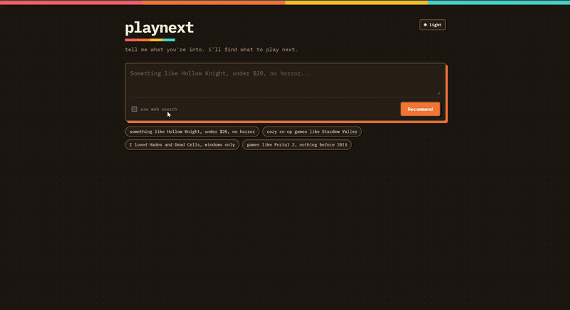
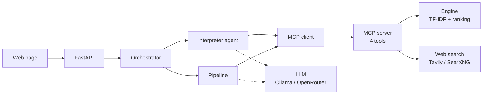

# playnext

A Steam game recommender built as a hands-on project for **MCP, multi-agent design and FastAPI**. Tell it what you like in plain English ("something like Hollow Knight, under $20, no horror") and it returns games from a 144K-game Steam dataset, with a reason for each pick.

**Live demo:** https://hiteshleburu-playnext.hf.space
(Hosted on a Hugging Face Space. It may be asleep, so the first request can take a minute, or it may be offline.)



## How it works



The website only ever talks to FastAPI. The agents and pipeline talk to the engine only through MCP tools.

1. **Interpreter agent** turns free text into a structured request: liked games, price cap, platforms, tags to require or exclude, and so on.
2. **Pipeline** asks the web what is similar to each liked game, keeps only titles that really appear in the search results and really exist in the dataset, and passes them to the engine as extra candidates.
3. **Engine** ranks everything and returns the final list.

### Engine

Plain Python with no LLM, MCP or web framework in it.

- **Retrieval:** cosine similarity over four TF-IDF blocks (tags 0.5, description 0.3, genres 0.1, developers/publishers 0.1). The weights are hand-set, not learned.
- **Ranking:** similarity blended with review quality (Wilson lower bound of the positive-review rate) and popularity (log review count).
- **Re-ranking:** MMR for diversity, caps per developer and franchise, and a nudge so every liked game gets its share of the final list.

### Guardrails

Hard filters are applied before anything is scored, so a bad result cannot slip through:

- Never recommend a game the user already owns, wishlisted or liked.
- Only games that exist in the dataset: no invented titles.
- Price, platform, tag and playtime limits are hard filters, not hints.
- Skip games with too few reviews, unreleased games, soundtracks and demos.
- Adult content is filtered by tags and age rating, and VR-only games are off by default.
- Adult content is **not** a tool argument, so a model or web text cannot switch it on. Only the operator can (`--allow-adult` or `PLAYNEXT_ALLOW_ADULT=1`).

### LLM proposes, code verifies

Models make mistakes, so every model output is checked by code:

- Titles extracted from search results must literally appear in the result text and must resolve strictly to a dataset game.
- Filters from the Interpreter must be backed by the user's own words: tags have to exist in the dataset, and numbers have to be written by the user. A price regex catches "under $20" if the model misses it.
- Search results are treated as untrusted text. They are only data, never instructions.

### MCP server

Four tools, run over stdio by default or streamable HTTP (`--transport streamable-http --port 8000`):

| Tool | What it does |
|---|---|
| `find_games` | Look up a title and get its `app_id` |
| `recommend` | Rank games for liked games, with filters, tag boosts and web candidates |
| `search_tags` | Find the real tag names in the dataset |
| `web_search` | Search the web (results marked untrusted) |

## API

| Endpoint | Purpose |
|---|---|
| `POST /recommend/text` | Free text in, recommendations out (uses the Interpreter) |
| `POST /recommend` | Structured input: liked games `{app_id, name, weight}` plus filters |
| `GET /games/search?q=` | Title search for a dropdown |
| `GET /health` | Health check |
| `GET /` | The web page |
| `GET /docs` | Interactive API docs |

One MCP connection is opened at startup and shared by all requests, so the engine is built once.

## Run it locally

```bash
python -m venv .venv
source .venv/bin/activate          # Windows: .venv\Scripts\activate
pip install -r requirements.txt
```

Download the Steam games dataset from Kaggle (a JSON file keyed by Steam app ID), save it as `data/games.json`, and build the slimmed table:

```bash
python src/prepare_data.py --input data/games.json --output data/games_slim.pkl
```

Create a `.env` file (see below), then start the API and open http://127.0.0.1:8001:

```bash
python src/api.py
```

Or use the command line:

```bash
python src/orchestrator.py 'games like Hades, under $20, no horror' --trace
```

In PowerShell, use single quotes. Inside double quotes `$20` is treated as a variable.

### Configuration (`.env`)

| Variable | Purpose |
|---|---|
| `LLM_PROVIDER` | `ollama` (default) or `openrouter` |
| `LLM_MODEL` | Override the model for either provider |
| `OPENROUTER_API_KEY`, `OPENROUTER_MODEL` | OpenRouter key and model |
| `TAVILY_API_KEY` | Use Tavily for web search (otherwise a local SearXNG is used) |
| `SEARXNG_URL`, `SEARXNG_SECRET` | Local SearXNG (`docker compose up -d`) |
| `PLAYNEXT_DATA` | Path to the dataset (default `data/games_slim.pkl`) |
| `MCP_SERVER_URL` | Connect to an MCP server you started yourself |
| `PLAYNEXT_CORS_ORIGINS` | Allowed website origins for CORS |
| `PORT` | API port (default 8001) |

For Ollama, install it and pull a model, for example `ollama pull qwen2.5:7b-instruct`. Small models work for this task, but bigger ones follow the "JSON only" instruction more reliably.

## Deploy

The `Dockerfile` packages the API, agents, MCP server, engine and dataset into one container that listens on port 7860. The MCP server runs as a child process of the API over stdio. Set the secrets (`LLM_PROVIDER`, `OPENROUTER_API_KEY`, `TAVILY_API_KEY`) in your host's settings and do not commit `.env`. The demo runs as a Docker Space on Hugging Face.

## Project layout

```
src/
  engine.py         recommendation engine (TF-IDF, scoring, MMR, guardrails)
  mcp_server.py     MCP server and its four tools
  web_search.py     Tavily / SearXNG client with a disk cache
  connection.py     MCP client helpers
  agents.py         the generic tool-using agent loop
  interpreter.py    Interpreter agent and the grounding checks
  pipeline.py       web candidates + engine
  orchestrator.py   text request -> Interpreter -> pipeline
  titles.py         strict title matching
  llm.py            OpenAI-compatible client for Ollama and OpenRouter
  api.py            FastAPI app
  prepare_data.py   builds the slimmed dataset
web/index.html      the front end
tests/              pytest suite
```

## Known limitations

- Recommendations are tag- and text-based. There is no user interaction data, so it can favor niche games with well-tagged pages.
- Very recent games with few reviews or tags cannot be recommended.
- A title the web writes differently from the dataset (for example "Hades 2" vs "Hades II") is dropped by the strict matcher. The engine can still surface the game, but without the web bonus.
- Liked games that are not on Steam are not used yet.
- The Interpreter is only as good as the model behind it. Small models sometimes miss filters, and the grounding checks drop anything they cannot verify.
- No rate limiting yet, so a public deployment spends its owner's LLM and search credits.

## Roadmap

- [x] Data prep, engine, MCP server, Interpreter agent, FastAPI, web page, Docker
- [ ] Cache the engine's feature matrix on disk for faster startup
- [ ] Rate limiting and early exit when the client disconnects
- [ ] Critic agent: loosen filters and retry when results are thin
- [ ] Explainer agent: "because you liked X" blurbs
- [ ] Use liked games that are not on Steam for web search
- [ ] Streaming responses
- [ ] Small evaluation set: engine alone vs engine plus agents